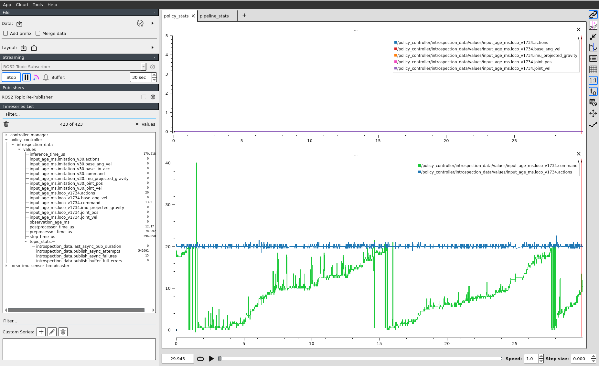
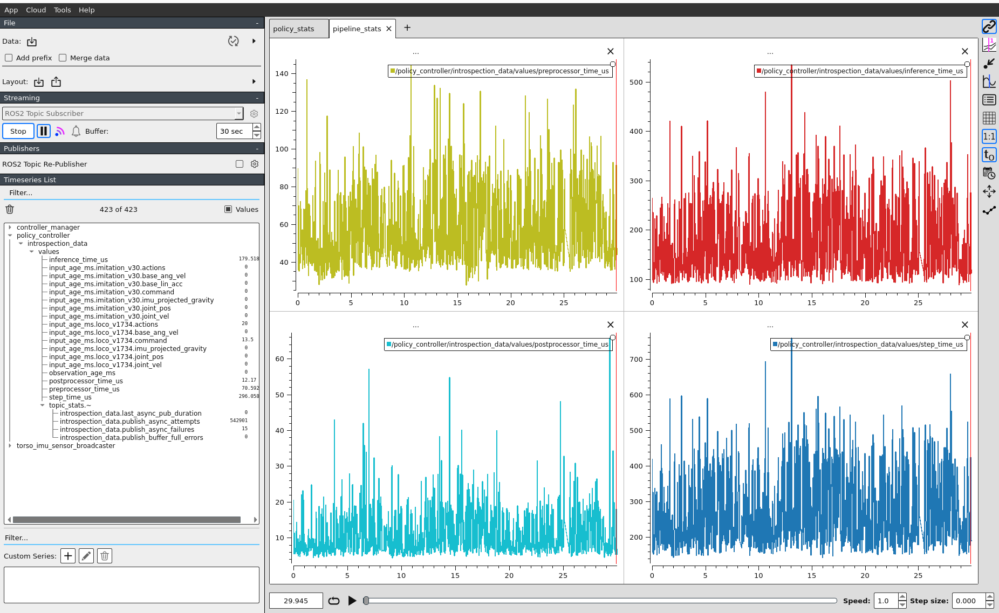

Data flow
=========

This page follows the data through one policy step and explains the two data types every
piece exchanges: the *stores* and the *tensors*.

The stores
----------

A store (``DataStore``) is a flat table. Each row, called an *entry*, has:

- a **name**, for example ``leg_left_1_joint/position``;
- a **value**, one floating point number;
- a **stamp**, the time the value was produced, in seconds;
- a **received** flag, false until the entry is written for the first time.

There are two stores: the **state store** for inputs and the **command store** for outputs.

Names follow the ros2_control convention ``<prefix>/<interface>``:

.. list-table::
   :header-rows: 1
   :widths: 45 55

   * - Entry
     - What it is
   * - ``leg_left_1_joint/position``
     - A joint position (state), or a joint position reference (command)
   * - ``torso_imu_sensor/orientation.x``
     - One component of the IMU orientation quaternion
   * - ``cmd_vel/linear.x``
     - The forward velocity the user asks for
   * - ``leg_left_1_joint/stiffness``
     - The proportional gain a policy wants for that joint (command)

Using these names has a practical consequence. A topic source writes the same entry names
that the equivalent state interfaces have. So whether a joint position comes from the
``/joint_states`` topic or from a state interface is a matter of configuration only: the
policy reads ``leg_left_1_joint/position`` in both cases.

Entries are created once, while the plugins configure themselves: every plugin *registers*
the entries it reads or writes and keeps their index. During the control cycle the plugins
only use those indices. Nothing is looked up by name and nothing is allocated, which keeps
the cycle fast and predictable.

The tensors
-----------

Between the three stages of a policy the data is no longer named numbers but *tensors*: the
blocks of ``float32`` values the model takes and returns, keyed by the model's input and
output names (``TensorMap``). A typical policy has one input tensor ``obs`` and one output
tensor ``actions``; a vision policy also has an image input (e.g. ``image [1, 3, H, W]``), filled
by an input term straight from the camera topic, not through the state store.

One step
--------

.. graphviz::

   digraph step {
     rankdir=TB;
     node [shape=box, style="rounded,filled", fillcolor="#eef3fb", fontname="Helvetica", fontsize=11];
     edge [fontname="Helvetica", fontsize=10];

     sensors [label="Sensors and user commands", shape=plaintext, fillcolor=none];
     read [label="1. Read inputs\ntopic sources and state interfaces"];
     state [label="State store", shape=cylinder, fillcolor="#fff6d9"];
     kin [label="2. Kinematics\n(if enabled)"];
     safety [label="3. Safety checks\nmonitor + SafetyCheck plugins", fillcolor="#fff6d9"];
     fault [label="Fault reaction\n(see Safety)", fillcolor="#fde8e8"];
     pre [label="4. Preprocessor\nobservation terms + history"];
     inf [label="5. Inference\nmodel(obs) = actions"];
     post [label="6. Postprocessor\nscale, offset, gains"];
     commands [label="Command store", shape=cylinder, fillcolor="#fff6d9"];
     ages [label="7. Input ages\nmax_age of the terms", fillcolor="#fff6d9"];
     exec [label="8. Executors\npublish or write interfaces"];
     robot [label="Robot", shape=plaintext, fillcolor=none];

     sensors -> read -> state -> kin -> safety -> pre;
     safety -> fault [label="a check fails"];
     pre -> inf [label="input tensors"];
     inf -> post [label="output tensors"];
     inf -> fault [label="step fails"];
     post -> commands -> ages -> exec -> robot;
     ages -> fault [label="an input is stale:\ncommands not applied"];
     inf -> pre [label="previous outputs\n(next step)", style=dashed, constraint=false];
   }

#. **Read inputs.** Topic sources copy their latest message into the state store. In the
   controller, the state interfaces are copied too.
#. **Kinematics.** When enabled, the robot model is updated from the joint entries
   (:doc:`kinematics`).
#. **Safety checks.** They look at the state before the policy acts on it; a failing one
   applies its reaction (:doc:`safety`). While a reaction other than neutral commands is
   latched, the policy is not stepped: the node sends nothing, the controller's executors
   apply the reaction.
#. **Preprocessor.** Reads the state store and fills the model's input tensors. This is where
   the observation is built: each observation term computes its current value, and the
   history of past values is kept. If an input has never been received, the preprocessor
   says so and the step is skipped: the policy *waits for data*.
#. **Inference.** Runs the model. It is the only stage that depends on the model format;
   the framework ships ``OnnxInference`` (ONNX Runtime, on the CPU).
#. **Postprocessor.** Reads the output tensors and writes named commands: typically a position
   reference per joint, computed as ``scale * action + offset``. A stage that fails, or a
   non-finite model output, is a fault (``on_policy_failure``).
#. **Input ages.** The terms with their own subscription and a ``max_age`` are checked: if
   one stopped receiving, the step's commands are not applied and its reaction is latched.
#. **Executors.** Send the command store to the robot.

In the controller only the topic sources and steps 4 to 7 wait for a policy tick; the state
interfaces, the kinematics, the safety checks and the executors run on every update
(:doc:`hosts`).

The dashed arrow is the feedback many policies need: the preprocessor also receives the
outputs of the *previous* step of the same policy. That is how the "last action" observation
term works, and how a motion policy feeds its own predicted reference back to itself.

Time stamps
-----------

Every entry carries the time its data was produced. The stamps travel with the data:

.. list-table::
   :header-rows: 1
   :widths: 40 60

   * - Data
     - Its stamp
   * - Entry written by a topic source
     - The message header stamp, or the time it is read when the message has none (a Twist)
   * - Entry read from a state interface
     - The time of the update that read it
   * - User command term (derived from ``CommandTerm``)
     - The message header stamp, or its receive time when the message has none (a Twist), so
       that its input age is how long ago it arrived; the neutral command is stamped when it
       is written
   * - Observation of a step
     - The oldest stamp among its inputs. Inputs fed back from the previous outputs do not
       count, nor do user commands (the terms derived from ``CommandTerm``, see
       :doc:`extending`): a command is held until its own timeout, so it is old by design,
       and counting it would hide a stale sensor behind it
   * - Command entry
     - The stamp of the observation it was computed from

This makes two questions answerable at any time: *how old was the data the policy just
acted on?* and *how long did it take from sensor to command?* The controller publishes the
first as ``observation_age_ms``, the age of each input of the active policy as
``input_age_ms.<policy>.<input>``, and the duration of each step as ``step_time_us`` (with
its stages as ``preprocessor_time_us``, ``inference_time_us`` and ``postprocessor_time_us``)
on its own topic, ``/<controller>/introspection_data``.

Introspection
-------------

``PolicyController`` publishes its timings and input ages with `pal_statistics
<https://github.com/pal-robotics/pal_statistics>`_, the library behind ros2_control's
`introspection <https://control.ros.org/rolling/doc/ros2_control/doc/introspection.html>`_,
but on its own topic instead of the controller manager's shared
``/controller_manager/introspection_data``. On every update it publishes:

.. list-table::
   :header-rows: 1
   :widths: 35 65

   * - Name
     - Meaning
   * - ``step_time_us``
     - Total duration of the last policy step: its three stages plus the work around them
       (policy switch, inactive policies observing), so at least their sum
   * - ``preprocessor_time_us``, ``inference_time_us``, ``postprocessor_time_us``
     - Duration of each stage of that step; 0 for a stage that did not run (e.g. inference
       while the preprocessor waits for data)
   * - ``observation_age_ms``
     - Age of the observation of that step when its commands were applied
   * - ``input_age_ms.<policy>.<input>``
     - Age of each input of the active policy; 0 for the inputs of inactive policies

The registry also adds its own ``topic_stats.*`` entries, e.g. how many asynchronous
publications were attempted and failed.

These values are published on three topics, under the controller's namespace (e.g.
``/policy_controller``):

- ``~/introspection_data/full``: names and values in one message, for the command line
  (``ros2 topic echo /policy_controller/introspection_data/full``) or custom tools.
- ``~/introspection_data/names``: the names, published again only when they change (e.g. on
  reconfiguration). Latched.
- ``~/introspection_data/values``: the values only, on every update.

Prefer ``names`` and ``values`` for plotting and recording: they carry far less data than
``full`` at the update rate.

Visualizing with PlotJuggler
^^^^^^^^^^^^^^^^^^^^^^^^^^^^

`PlotJuggler <https://github.com/facontidavide/PlotJuggler>`_ plots these values live or from
a bag:

1. Start it with ``ros2 run plotjuggler plotjuggler``.
2. Under *Streaming*, choose *ROS2 Topic Subscriber* and press *Start*. Or load a bag
   recorded with
   ``ros2 bag record /policy_controller/introspection_data/names /policy_controller/introspection_data/values``.
3. Select ``/policy_controller/introspection_data/names`` and
   ``/policy_controller/introspection_data/values``.
4. Drag the values of interest from the *Timeseries List* onto a plot.

   Input ages of the active policy ``loco_v1734``. The state inputs (joint positions and
   velocities, IMU) are read from state interfaces in the same update, so they are 0. Here
   ``actions``, fed back from the previous step's outputs, are about 20 ms old.
   ``command`` is a user command: its age grows until the next message arrives, then drops
   back (a command is held until its own timeout). The inputs of the inactive
   ``imitation_v30`` stay at 0.

         the whole step
   :width: 100%

   Durations of the preprocessor, inference and postprocessor, and of the whole step
   (``step_time_us``). Here inference takes most of the step, and its spikes show directly
   in the step time. Compare ``step_time_us`` with the policy period to check the step fits.
